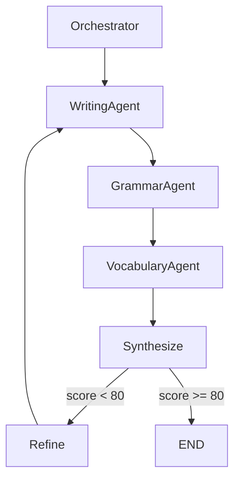

# LangGraph vs LangChain - ExamLex 技术选型分析

**结论：LangGraph 更适合 ExamLex 的多 Agent 架构！**

---

## 🎯 为什么 LangGraph 更好？

### LangChain 的局限

**LangChain Agent**：
```python
# LangChain 的 Agent 是线性的
agent = create_react_agent(llm, tools, prompt)
result = agent.invoke({"input": "分析作文"})
# ❌ 难以实现复杂的多 Agent 协作
# ❌ 难以实现循环和条件分支
# ❌ 状态管理复杂
```

**问题**：
- ❌ Agent 之间的协作需要手动编排
- ❌ 状态管理不清晰
- ❌ 难以实现"Orchestrator → Writing Agent → Vocabulary Agent → 反馈"这样的复杂流程
- ❌ 调试困难

---

### LangGraph 的优势

**LangGraph**：
```python
from langgraph.graph import StateGraph, END

# 定义状态
class ExamLexState(TypedDict):
    essay: str
    grammar_issues: List[str]
    vocabulary_suggestions: List[str]
    final_feedback: str

# 定义图
workflow = StateGraph(ExamLexState)

# 添加节点（Agent）
workflow.add_node("writing_agent", writing_agent_node)
workflow.add_node("vocabulary_agent", vocabulary_agent_node)
workflow.add_node("orchestrator", orchestrator_node)

# 添加边（流程）
workflow.add_edge("orchestrator", "writing_agent")
workflow.add_edge("writing_agent", "vocabulary_agent")
workflow.add_conditional_edges(
    "vocabulary_agent",
    should_continue,
    {
        "continue": "writing_agent",  # 循环优化
        "end": END
    }
)

# 编译
app = workflow.compile()
result = app.invoke({"essay": student_essay})
```

**优势**：
- ✅ **清晰的状态管理** - 每个节点都能访问和修改状态
- ✅ **可视化工作流** - 自动生成流程图
- ✅ **条件分支** - 根据结果决定下一步
- ✅ **循环支持** - Agent 可以反复优化
- ✅ **并行执行** - 多个 Agent 可以同时工作
- ✅ **易于调试** - 每一步的状态都可见
- ✅ **人机协作** - 可以在流程中暂停，等待用户输入

---

## 🏗️ ExamLex 的 LangGraph 架构

### 架构图

```
                  ┌─────────────────┐
                  │  User Input     │
                  │  (学生提交作文)   │
                  └────────┬────────┘
                           │
                           ▼
                  ┌─────────────────┐
                  │  Orchestrator   │
                  │  (分析任务)      │
                  └────────┬────────┘
                           │
           ┌───────────────┼───────────────┐
           │               │               │
           ▼               ▼               ▼
    ┌──────────┐    ┌──────────┐    ┌──────────┐
    │ Writing  │    │ Grammar  │    │Vocabulary│
    │  Agent   │    │  Agent   │    │  Agent   │
    └─────┬────┘    └─────┬────┘    └─────┬────┘
          │               │               │
          └───────────────┼───────────────┘
                          │
                          ▼
                   ┌──────────────┐
                   │   Synthesize │
                   │   (综合反馈)  │
                   └──────┬───────┘
                          │
                          ▼
                   ┌──────────────┐
                   │Should Refine?│
                   │  (需要优化?)  │
                   └──────┬───────┘
                          │
                    ┌─────┴─────┐
                    │           │
                   Yes         No
                    │           │
            ┌───────┘           └──────┐
            │                          │
            ▼                          ▼
    ┌──────────────┐           ┌──────────────┐
    │ Refine Essay │           │    END       │
    │ (优化作文)    │           │ (输出结果)    │
    └──────┬───────┘           └──────────────┘
           │
           └─────────┐
                     │
                     ▼
            (循环回 Writing Agent)
```

---

## 💻 完整代码示例

### 1. 定义状态

```python
from typing import TypedDict, List, Annotated
from langgraph.graph import StateGraph, END
from langchain_openai import ChatOpenAI

class EssayReviewState(TypedDict):
    """作文批改的状态"""
    # 输入
    essay: str
    exam_type: str
    
    # 中间结果
    grammar_issues: List[dict]
    structure_analysis: dict
    vocabulary_suggestions: List[dict]
    
    # 输出
    final_feedback: str
    revised_essay: str
    score: int
    
    # 控制
    iteration_count: int
    needs_refinement: bool
```

---

### 2. 定义节点（Agent）

```python
def orchestrator_node(state: EssayReviewState) -> EssayReviewState:
    """协调者：分析任务，决定优先级"""
    print("🎯 Orchestrator: 分析任务...")
    
    # 初始化
    state["iteration_count"] = 0
    state["needs_refinement"] = True
    
    return state

def writing_agent_node(state: EssayReviewState) -> EssayReviewState:
    """写作 Agent：分析结构和论证"""
    print("📝 Writing Agent: 分析作文结构...")
    
    llm = ChatOpenAI(model="gpt-4", temperature=0)
    
    prompt = f"""
    你是一位英语写作导师。请分析以下作文的结构：
    
    作文：
    {state['essay']}
    
    请从以下维度分析：
    1. 三段式结构是否清晰
    2. 论点是否明确
    3. 论据是否充分
    4. 逻辑连接是否流畅
    
    以 JSON 格式返回。
    """
    
    response = llm.invoke(prompt)
    
    # 解析结果（简化）
    state["structure_analysis"] = {
        "score": 75,
        "issues": ["论据不够充分", "缺少逻辑连接词"],
        "suggestions": ["添加具体例子", "使用 Furthermore, Moreover 等"]
    }
    
    return state

def grammar_agent_node(state: EssayReviewState) -> EssayReviewState:
    """语法 Agent：检查语法错误"""
    print("🔍 Grammar Agent: 检查语法...")
    
    llm = ChatOpenAI(model="gpt-4", temperature=0)
    
    prompt = f"""
    请检查以下作文的语法错误：
    
    {state['essay']}
    
    找出所有语法错误，包括时态、语态、主谓一致等。
    以 JSON 列表格式返回，每个错误包括 location, error, correction。
    """
    
    response = llm.invoke(prompt)
    
    # 解析结果（简化）
    state["grammar_issues"] = [
        {"location": "第1段第2句", "error": "时态错误", "correction": "应该用过去时"},
        {"location": "第2段第1句", "error": "主谓不一致", "correction": "主语是复数，动词应该用复数形式"}
    ]
    
    return state

def vocabulary_agent_node(state: EssayReviewState) -> EssayReviewState:
    """词汇 Agent：词汇分析和建议"""
    print("📚 Vocabulary Agent: 分析词汇...")
    
    llm = ChatOpenAI(model="gpt-4", temperature=0)
    
    prompt = f"""
    请分析以下作文的词汇使用：
    
    {state['essay']}
    
    找出：
    1. 重复使用的词汇
    2. 可以提升的表达
    3. 高分替换词
    
    以 JSON 列表格式返回。
    """
    
    response = llm.invoke(prompt)
    
    # 解析结果（简化）
    state["vocabulary_suggestions"] = [
        {"original": "very important", "suggestion": "crucial / vital", "reason": "更学术化"},
        {"original": "a lot of", "suggestion": "numerous / a substantial number of", "reason": "避免口语化"}
    ]
    
    return state

def synthesize_node(state: EssayReviewState) -> EssayReviewState:
    """综合反馈节点"""
    print("🔄 Synthesize: 综合各 Agent 的反馈...")
    
    # 综合分数
    grammar_score = 100 - len(state["grammar_issues"]) * 5
    structure_score = state["structure_analysis"]["score"]
    vocab_score = 100 - len(state["vocabulary_suggestions"]) * 3
    
    state["score"] = int((grammar_score + structure_score + vocab_score) / 3)
    
    # 生成综合反馈
    state["final_feedback"] = f"""
    作文评分：{state['score']}/100
    
    1. 结构分析：
    {state['structure_analysis']}
    
    2. 语法问题（{len(state['grammar_issues'])}个）：
    {state['grammar_issues']}
    
    3. 词汇建议（{len(state['vocabulary_suggestions'])}个）：
    {state['vocabulary_suggestions']}
    """
    
    return state

def should_refine(state: EssayReviewState) -> str:
    """决定是否需要优化"""
    state["iteration_count"] += 1
    
    # 如果分数低于80且迭代次数少于3次，继续优化
    if state["score"] < 80 and state["iteration_count"] < 3:
        print(f"♻️  分数 {state['score']} < 80，需要优化（第 {state['iteration_count']} 轮）")
        return "refine"
    else:
        print(f"✅ 分数 {state['score']} >= 80 或已达到最大迭代次数，结束")
        return "end"

def refine_essay_node(state: EssayReviewState) -> EssayReviewState:
    """根据反馈优化作文"""
    print("✨ Refine: 根据反馈优化作文...")
    
    llm = ChatOpenAI(model="gpt-4", temperature=0.3)
    
    prompt = f"""
    请根据以下反馈优化作文：
    
    原作文：
    {state['essay']}
    
    反馈：
    {state['final_feedback']}
    
    请输出优化后的作文。
    """
    
    response = llm.invoke(prompt)
    
    # 更新作文
    state["essay"] = response.content
    state["revised_essay"] = response.content
    
    return state
```

---

### 3. 构建图

```python
# 创建图
workflow = StateGraph(EssayReviewState)

# 添加节点
workflow.add_node("orchestrator", orchestrator_node)
workflow.add_node("writing_agent", writing_agent_node)
workflow.add_node("grammar_agent", grammar_agent_node)
workflow.add_node("vocabulary_agent", vocabulary_agent_node)
workflow.add_node("synthesize", synthesize_node)
workflow.add_node("refine", refine_essay_node)

# 设置入口
workflow.set_entry_point("orchestrator")

# 添加边（线性流程）
workflow.add_edge("orchestrator", "writing_agent")
workflow.add_edge("writing_agent", "grammar_agent")
workflow.add_edge("grammar_agent", "vocabulary_agent")
workflow.add_edge("vocabulary_agent", "synthesize")

# 添加条件边（决定是否优化）
workflow.add_conditional_edges(
    "synthesize",
    should_refine,
    {
        "refine": "refine",
        "end": END
    }
)

# 优化后回到 writing_agent（循环）
workflow.add_edge("refine", "writing_agent")

# 编译
app = workflow.compile()
```

---

### 4. 运行

```python
# 输入
student_essay = """
Nowadays, many people think that social media is very important. 
I agree with this opinion. There are a lot of reasons.

First, social media helps us connect with friends. We can talk to them anytime.
Second, we can learn a lot of things from social media.

In conclusion, social media is very important for our life.
"""

# 执行工作流
result = app.invoke({
    "essay": student_essay,
    "exam_type": "CET-6"
})

# 输出结果
print("\n" + "="*60)
print("📊 最终结果")
print("="*60)
print(f"评分：{result['score']}/100")
print(f"\n反馈：\n{result['final_feedback']}")
if "revised_essay" in result:
    print(f"\n优化后的作文：\n{result['revised_essay']}")
```

---

### 5. 可视化工作流

```python
from IPython.display import Image, display

# 生成流程图
display(Image(app.get_graph().draw_mermaid_png()))
```

**生成的图**：


---

## 🎯 ExamLex 完整架构（LangGraph 版）

### 多 Agent 并行执行

```python
from langgraph.graph import StateGraph, END

class ComprehensiveReviewState(TypedDict):
    """完整的学习分析状态"""
    # 输入
    essay: str
    listening_audio: str
    reading_passage: str
    
    # 各 Agent 的结果
    writing_feedback: dict
    listening_feedback: dict
    reading_feedback: dict
    vocabulary_feedback: dict
    
    # 综合结果
    daily_plan: dict
    weak_points: List[str]
    recommendations: List[str]

# 定义并行节点
def parallel_analysis(state: ComprehensiveReviewState):
    """并行执行多个 Agent"""
    # LangGraph 支持并行节点
    pass

# 构建图
workflow = StateGraph(ComprehensiveReviewState)

# 添加并行节点
workflow.add_node("writing_analysis", writing_agent_node)
workflow.add_node("listening_analysis", listening_agent_node)
workflow.add_node("reading_analysis", reading_agent_node)

# 从 orchestrator 同时触发三个 Agent
workflow.set_entry_point("orchestrator")
workflow.add_edge("orchestrator", "writing_analysis")
workflow.add_edge("orchestrator", "listening_analysis")
workflow.add_edge("orchestrator", "reading_analysis")

# 等待三个 Agent 都完成后，进入综合节点
workflow.add_edge("writing_analysis", "synthesize")
workflow.add_edge("listening_analysis", "synthesize")
workflow.add_edge("reading_analysis", "synthesize")

workflow.add_edge("synthesize", END)

app = workflow.compile()
```

---

## 📊 技术对比

| 特性 | LangChain Agent | LangGraph | crewAI |
|------|----------------|-----------|--------|
| 状态管理 | ❌ 需要手动 | ✅ 内置 | ✅ 内置 |
| 可视化 | ❌ 无 | ✅ 自动生成图 | ❌ 无 |
| 条件分支 | ❌ 难实现 | ✅ 原生支持 | ⚠️ 有限支持 |
| 循环优化 | ❌ 难实现 | ✅ 原生支持 | ❌ 不支持 |
| 并行执行 | ❌ 手动编排 | ✅ 原生支持 | ✅ 原生支持 |
| 人机协作 | ❌ 不支持 | ✅ 中断/恢复 | ⚠️ 有限支持 |
| 调试难度 | ⚠️ 较难 | ✅ 简单 | ⚠️ 中等 |
| 学习曲线 | ⚠️ 中等 | ✅ 低 | ✅ 低 |
| 适用场景 | 简单任务 | **复杂工作流** | 团队协作 |

---

## 🎯 结论：ExamLex 应该用 LangGraph！

### 为什么？

1. ✅ **天然支持多 Agent 协作**
2. ✅ **清晰的状态管理**
3. ✅ **支持循环优化**（作文可以反复改进）
4. ✅ **可视化工作流**（方便调试）
5. ✅ **条件分支**（根据分数决定是否继续）
6. ✅ **并行执行**（多个 Agent 同时分析）
7. ✅ **人机协作**（可以在流程中等待用户输入）

### 技术栈

```
核心：LangGraph + LangChain
LLM：OpenAI GPT-4 / Claude / 本地模型
向量数据库：ChromaDB / FAISS（用于 RAG）
后端：FastAPI
前端：现有 ExamLex
```

---

## 🚀 立即开始

要不要现在就用 LangGraph 实现第一个完整的作文批改工作流？

我会帮你：
1. 安装 LangGraph
2. 编写完整的工作流
3. 集成到 ExamLex
4. 可视化流程图

**只需要 2-3 小时就能看到完整的多 Agent 协作！** 🎉
