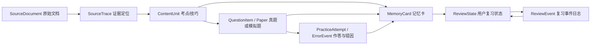

# ExamLex 记忆卡功能架构审查稿

状态：Design Review（设计审查），未进入实现阶段。

## 1. 功能命题

记忆卡不是独立的“背词页”，而是 ExamLex 学习闭环中的 Recall Loop（回忆闭环）：

```text
来源证据 -> 考点/技巧 -> 真题或练习 -> 作答与错因 -> 记忆卡 -> 间隔复习 -> 新的作答证据
```

每张卡都回答三个问题：

1. 我需要记住什么？
2. 它来自哪份资料、哪道题或哪次错误？
3. 我下一次应该在什么时候复习？

“精准复习”在产品中定义为 deterministic and traceable（可重复、可追溯）的复习调度，不宣称能精确预测每个人的大脑遗忘曲线。

## 2. 信息架构

### 顶层入口

在现有工作区增加 `06 记忆卡`，并在首页保留一个轻量入口：

- `今日待复习`：到期卡、逾期卡、新卡。
- `复习进度`：今日完成数、连续完成天数、当前最长间隔。
- `Memory Ribbon`：继续保留首页的学习节奏轨迹，点击节点后进入对应的复习队列。

### 记忆卡页面

1. `今日队列`：按 due_at（到期时间）、逾期天数和薄弱模块排序。
2. `卡组`：按考试、模块、卡片类型、来源文档筛选。
3. `复习工作台`：一次只处理一张卡，避免信息噪声。
4. `卡片详情`：查看来源页码、段落、题号、错误记录和关联考点。
5. `复习统计`：查看完成率、遗忘率、平均间隔和各模块记忆负担。

### 卡片类型

- `vocabulary`：词汇、词性、义项、易混词。
- `phrase`：短语、搭配和固定表达。
- `grammar`：基础句型、从句、倒装、虚拟等结构。
- `listening`：音素拆分、混淆发音、英美发音、连读缩读、重弱读。
- `reading`：定位、同义改写、干扰项和题型策略。
- `translation`：中文信息块、常用词句和句法转换。
- `writing`：高分表达、论证方式、模板结构和改写练习。

## 3. 核心复习交互

复习页采用“先回忆、后核对、再评分”的三段式流程：

1. **Recall**：只显示 front（正面），例如中文提示、句子缺口、听音辨词或阅读陷阱。
2. **Reveal**：用户点击或按键揭示 back（背面），显示答案、解释、短例句和来源证据。
3. **Rate**：用户选择 `Again / Hard / Good / Easy`，系统记录 ReviewEvent（复习事件）并生成下一次到期时间。

辅助操作：

- `空格`：揭示答案。
- `1-4`：对应四种评分。
- `左右方向键`：切换卡片或展开来源证据。
- 移动端使用底部固定操作区，保证单手可完成。
- `prefers-reduced-motion` 下保留状态变化和键盘/触控反馈，关闭连续运动。

卡片不直接复制整篇教材。背面只保留必要的考点摘要；完整解释通过来源抽屉按页、段、题号或音频时间戳展开。

## 4. Ebbinghaus 调度策略

默认 schedule_version 为 `ebbinghaus_v1`，时间间隔可由后端配置，初始建议如下：

| 阶段 | 默认间隔 |
| --- | ---: |
| 新卡首次复习 | 立即 |
| 短期巩固 | 10 分钟 |
| Stage 1 | 1 天 |
| Stage 2 | 2 天 |
| Stage 3 | 4 天 |
| Stage 4 | 7 天 |
| Stage 5 | 15 天 |
| Stage 6 | 30 天 |

评分规则：

- `Again`：进入 10 分钟重学队列，stage 重置或下降，lapses 加一。
- `Hard`：不推进或只推进半级，下一间隔取当前间隔的 0.5 倍，最短 10 分钟。
- `Good`：推进一级，使用下一阶段间隔。
- `Easy`：跳过一级并乘以 1.5，默认上限 60 天。

实现约束：

- 以用户时区计算 due_at，服务端统一存储 UTC。
- 复习请求带 idempotency_key（幂等键），重复提交不得产生两个事件。
- 逾期卡按逾期程度提高优先级，但不强制一天内堆积全部欠账。
- schedule_version 迁移时保留旧 ReviewEvent，不能静默改写历史。
- 现有 error-tag urgency 只作为新卡初始优先级，不替代调度算法。

## 5. 数据关系与来源追踪



`MemoryCard` 最小字段：

```json
{
  "card_id": "card-...",
  "owner_id": "user-...",
  "exam_track": "cet6",
  "module": "listening",
  "card_type": "listening",
  "front": "辨别 /s/ 与 /θ/：thought 与 sought 的关键差异是什么？",
  "back": "...",
  "hint": "先看舌尖位置，再听摩擦音",
  "source_trace_ids": ["trace-..."],
  "generated_from": {"error_event_id": "err-..."},
  "lifecycle": "draft",
  "content_hash": "sha256:..."
}
```

`ReviewState` 是用户维度的可变快照；`ReviewEvent` 是 append-only（只追加）历史，必须保留评分、旧状态、新状态和时间。

真题和模拟题必须保持来源边界：

- `official_verified`：只有经过 A/S evidence（证据等级）和题目级页码/段落/内容 hash 校验才允许发布。
- 用户上传或 AI 生成的题目永远是 `simulation_not_official`。
- OCR 结果在人工复核前只能是 `draft`，不能自动变成官方真题或公共卡组。

## 6. 卡片生成入口

支持五种入口，但都必须保留来源：

1. 从内容单元手动生成。
2. 从错题和错误标签生成。
3. 从真题或模拟题的某个选项/解析生成。
4. 从文档上传后的已确认段落生成。
5. AI 生成草稿后由用户确认；前端只传 provider_id，API key 和 endpoint 由后端管理。

AI 生成卡片必须持久化 model_id、template_version、request_hash 和 source_refs，日志不得出现 Authorization 或 API key。

## 7. 前后端职责

### Frontend

- 展示待复习队列和单卡复习流程。
- 负责焦点状态、键盘操作、触控操作和 reduced-motion 降级。
- 只接收已授权的卡片、来源摘要和复习结果，不接收 provider secret。

### Backend / Core

- 负责卡片创建、来源权限、内容 hash、调度计算和事件幂等。
- 负责答案隔离：练习开始接口不能泄露 answer/explanation，提交后按策略揭示。
- 负责上传隔离、解析/OCR 状态、文件大小和压缩包安全限制。
- 保持 local-first；未来 Electron、Web 或桌面端只作为薄适配层。

建议 facade：

```text
create_card
list_due_cards
record_review
get_review_history
get_card_sources
create_upload
ingest_document
publish_document
```

## 8. 验收门槛

- 同一原件按 raw_sha256 去重，CRLF/LF 规范化后 canonical hash 稳定。
- 上传文件在 quarantine（隔离区）和人工确认前，不进入公共内容索引。
- 每张卡能回到来源文档、页码/段落/题号或错误事件。
- 重复 review 请求不产生重复 ReviewEvent。
- 时区、Again 重置、逾期处理和 schedule_version 迁移有自动化测试。
- 学习者接口不返回答案；前端构建产物和日志不出现 API key。
- 扫描 PDF/OCR 生成的卡片带有 OCR 状态与置信度，未经复核不发布。
- 生成任务结束后清理 C:/D: 临时解析目录，但保留用户原件、必要派生物和可恢复索引。

## 9. 暂不做的三件事

1. 不把记忆卡做成公开社交卡组：当前重点是个人备考闭环，避免版权和内容质量失控。
2. 不把 Ebbinghaus 结果包装成医学级“精准预测”：先保证调度可解释、可复现、可迁移。
3. 不在首版同时上线复杂音频合成和自动 OCR 全链路：扫描资料需要人工复核，先保证证据质量。

## 10. 当前审查结论

本方案可以作为 ExamLex 现有 `skills/examlex` Core 的扩展边界，兼容现有 JSON learner/practice/strategy 数据，不把现有 error summary 误当成完整 spaced repetition。当前只完成架构设计，尚未修改前端、后端或数据 schema。
